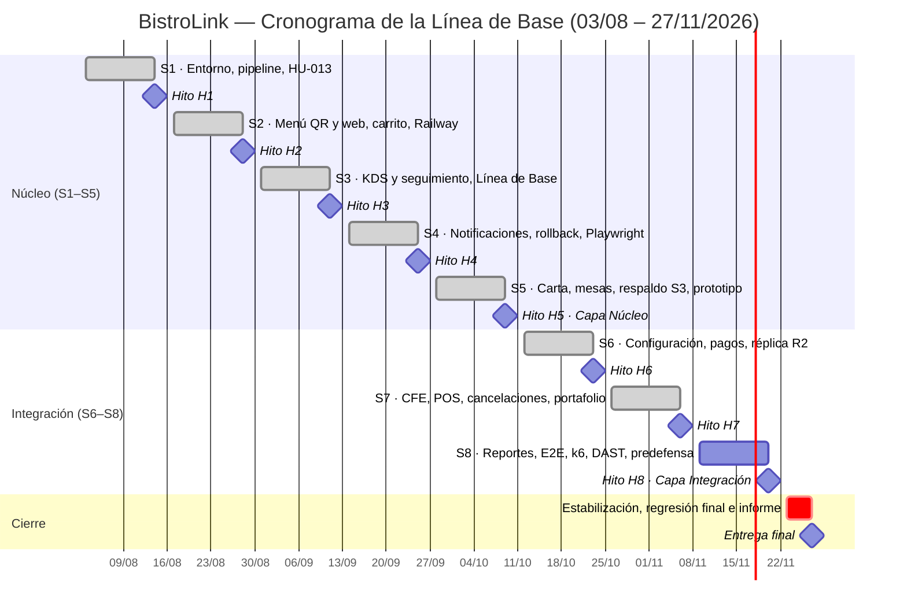

# 🚀 Dashboard de Avance del Proyecto

<!-- SOLO-REPO:start -->

> 📌 **La versión al día de este dashboard está publicada en GitHub Pages:** https://ved-virtualexperiencedevelopment.github.io/bistrolink/avance-edt.html (BL-298). Este archivo es la plantilla que usa el workflow «Publicar dashboards»: los bloques `AUTO` de acá no se actualizan en el repositorio.

<!-- SOLO-REPO:end -->

> **Nota de Control:** Las secciones marcadas con `<!-- AUTO -->` se generan desde Linear con `scripts/dashboards/update-dashboard-from-linear.mjs`. El avance del MVP se mide contra el backlog (`scripts/dashboards/backlog-hu.json`: Anexo 5 v2.3 más las solicitudes de cambio) y contra el plan de la Línea de Base (`scripts/dashboards/sprint-config.json`: Tabla 17 y Gantt v2.0). El resto de lo cerrado en Linear se muestra aparte, como trabajo técnico. Al aprobar una solicitud de cambio, se agrega la historia en `backlog-hu.json`.

---

## 📊 Estado general del proyecto

### Resumen ejecutivo

<!-- AUTO:resumen-ejecutivo:start -->
<!-- AUTO:resumen-ejecutivo:end -->

### Avance del MVP por grupo del backlog

<!-- AUTO:avance-por-grupo:start -->
<!-- AUTO:avance-por-grupo:end -->

### Avance del MVP por prioridad (MoSCoW)

<!-- AUTO:avance-por-prioridad:start -->
<!-- AUTO:avance-por-prioridad:end -->

---

## 📈 Avance contra la Línea de Base

### Burn-up del MVP

<!-- AUTO:burnup-mvp:start -->
<!-- AUTO:burnup-mvp:end -->

### Hitos: plan vs. real

<!-- AUTO:hitos-plan-vs-real:start -->
<!-- AUTO:hitos-plan-vs-real:end -->

### Cronograma (Anexo 8 — Gantt v2.0)

---

## 📋 Detalle de historias

### Historias del MVP pendientes

<!-- AUTO:historias-pendientes:start -->
<!-- AUTO:historias-pendientes:end -->

### Fuera del MVP

<!-- AUTO:fuera-del-mvp:start -->
<!-- AUTO:fuera-del-mvp:end -->

---

## ⚙️ Trabajo cerrado por Sprint (historias y trabajo técnico)

<!-- AUTO:throughput-por-sprint:start -->
<!-- AUTO:throughput-por-sprint:end -->

---

## 🔎 Control del backlog

<!-- AUTO:control-del-backlog:start -->
<!-- AUTO:control-del-backlog:end -->
