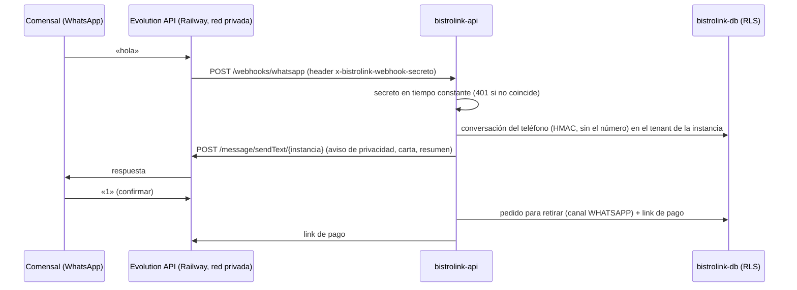

# Runbook: bot de pedidos por WhatsApp con Evolution API

> **Tickets:** BL-112 (HU-010), BL-605 (infraestructura) · **Relacionado:** HU-033 (link de pago), HU-036 (aviso de privacidad), HU-040 (pedidos para retirar), ADR 0003 (secretos en Infisical), ADR 0015 (Evolution).
> **Última revisión:** 22/11/2026.

## 1. Qué es

El comensal le escribe al número de WhatsApp del local y arma un **pedido para retirar** con la carta numerada. Al confirmar, la API crea el pedido con el canal `WHATSAPP` (las mismas reglas que el retiro web: franja horaria, stock y precios del servidor) y le manda el **link de pago** de HU-033. El pago y la entrega siguen el flujo de siempre; además, el bot le avisa por WhatsApp cuando se aprueba el pago (con el código de retiro R-NNN) y cuando cocina marca el pedido como listo (BL-604). Si Evolution no responde, el aviso no sale y el pago y el KDS siguen igual.

[Evolution API](https://github.com/evolution-foundation/evolution-api) conecta un número de WhatsApp como si fuera WhatsApp Web (Baileys) y nos reenvía cada mensaje por un webhook.



**Pasos de la conversación:** aviso de privacidad (sin aceptarlo no se toma el pedido) → carta numerada («3», «3 x2») → «0» para ver el resumen → «1» confirmar y pagar, «2» seguir, «3» vaciar. «menu» y «cancelar» sirven en cualquier paso. La conversación se olvida a los 30 minutos sin mensajes.

**Requisito del local:** tiene que tener habilitados los **pedidos para retirar** (Configuración). Fuera de la franja horaria el bot responde el horario y no toma pedidos.

## 2. Riesgos y límites (leer antes de conectar un número)

- **No es la API oficial de WhatsApp.** Evolution usa WhatsApp Web; Meta puede bloquear el número si detecta un uso automatizado. Usar **solo el chip del proyecto**, nunca un número personal ni el del local real.
- **No hay plantillas HSM de Meta.** Los textos del bot son fijos y están en el código (`apps/backend/src/whatsapp/conversacion.ts`). El criterio de aceptación original de HU-010 cambia por CR.
- **Una instancia, un tenant.** El mapeo instancia → tenant está en `EVOLUTION_INSTANCIAS`. Una pantalla para que cada local conecte su número queda fuera del MVP.

## 3. Estado por entorno

| Entorno        | Servicios en Railway                                              | Número                                             | Bot                                                               |
| -------------- | ----------------------------------------------------------------- | -------------------------------------------------- | ----------------------------------------------------------------- |
| **staging**    | `evolution`, `evolution-db`, `evolution-redis`                    | Chip del proyecto (instancia `bistrolink-staging`) | **Encendido**, atiende al tenant A del seed. Acá se hace la demo. |
| **production** | `evolution-prod-api`, `evolution-prod-db`, `evolution-prod-redis` | Ninguno                                            | **Apagado** a propósito: falta `EVOLUTION_INSTANCIAS`.            |

Un número no puede atender dos instancias a la vez (las dos contestarían cada mensaje). Para encender producción hace falta un segundo número, o mover el chip después de la defensa (§5.4).

## 4. Variables

| Variable                   | Dónde                        | Qué es                                                                                                        |
| -------------------------- | ---------------------------- | ------------------------------------------------------------------------------------------------------------- |
| `EVOLUTION_API_URL`        | Railway, servicio de la API  | `http://<dominio privado de Evolution>:8080`, **escrito literal** (ver abajo). Sin barra final.               |
| `EVOLUTION_INSTANCIAS`     | Railway, servicio de la API  | `instancia=tenantId`, separadas por coma. Staging: `bistrolink-staging=11111111-1111-1111-1111-111111111111`. |
| `EVOLUTION_API_KEY`        | **Infisical**, carpeta `api` | La API key global de Evolution. El servicio de Evolution la tiene en `AUTHENTICATION_API_KEY`.                |
| `WHATSAPP_WEBHOOK_SECRETO` | **Infisical**, carpeta `api` | Al menos 32 caracteres. Evolution lo manda en el header `x-bistrolink-webhook-secreto`.                       |
| `WHATSAPP_TELEFONO_CLAVE`  | **Infisical**, carpeta `api` | Al menos 32 caracteres. Clave del HMAC con el que se guarda el teléfono en la conversación.                   |

- Si falta cualquiera, o una no tiene el formato esperado, **el bot queda apagado**: el webhook responde 401 a todo y la API loguea «el bot no está configurado». La API arranca igual.
- **`EVOLUTION_API_URL` con el dominio literal**, no con una referencia `${{servicio.RAILWAY_PRIVATE_DOMAIN}}`. En staging la referencia quedó vacía porque el nombre del servicio no coincidía, y el bot quedó apagado sin un error visible. El dominio privado no es secreto: se copia de Evolution → Settings → Networking → Private Networking.
- Generar cada secreto con `node -e "console.log(require('crypto').randomBytes(32).toString('base64url'))"`. **Valores distintos por entorno** y distintos entre sí.
- Ningún valor va al repo, a Linear ni al chat. Si la sincronización de Infisical con Railway no está activa (BL-237), se cargan también a mano en Railway (ADR 0003).
- Cambiar `WHATSAPP_TELEFONO_CLAVE` solo hace que las conversaciones abiertas empiecen de nuevo (pide otra vez el aviso). No afecta a los pedidos.

## 5. Evolution en Railway

Cada entorno se arma **desde cero**: no se clona ni se sincroniza staging en producción, porque se copiarían sus claves. En Railway los nombres de servicio son únicos en todo el proyecto; producción usa el patrón `<sistema>-prod-<componente>`.

### 5.1 Servicios

1. **Postgres** («+ New» → Database → PostgreSQL) y **Redis** («+ New» → Database → Redis), propios de Evolution. Nunca `bistrolink-db`: Evolution crea sus propias tablas (57 migraciones en el primer arranque).
2. **Evolution** («+ New» → Docker Image) con la imagen fija **`evoapicloud/evolution-api:v2.3.7`**. No `latest`: las 2.4 piden activar una licencia antes de responder. La plantilla de Railway trae la 2.3.6 y no enlaza la base ni el Redis; por eso en producción se crea a mano.

### 5.2 Configuración de cada servicio

| Ajuste (Settings)        | Evolution                   | Postgres de Evolution  | Redis de Evolution     |
| ------------------------ | --------------------------- | ---------------------- | ---------------------- |
| Región                   | La misma que la API         | La misma que la API    | La misma que la API    |
| Límites (Replica Limits) | 1 vCPU · 1 GB               | 0,5 vCPU · 0,5 GB      | 0,5 vCPU · 0,5 GB      |
| Healthcheck Path         | `/` (timeout 120 s)         | No aplica (no es HTTP) | No aplica (no es HTTP) |
| Restart Policy           | On Failure                  | On Failure             | On Failure             |
| Serverless y Teardown    | Apagados                    | Apagados               | Apagados               |
| TCP Proxy (Networking)   | —                           | **Borrado**            | **Borrado**            |
| Dominio público          | Solo para el manager (§5.4) | No                     | No                     |

- 0,5 vCPU y 0,5 GB es el mínimo que permite Railway. Los límites los cambia un Admin del workspace. Railway cobra por lo usado, no por el límite: el límite evita que una falla se lleve los recursos de los demás. Revisar **Metrics** a los pocos días y subir Evolution a 1,5 GB si anda cerca de 1 GB.
- El healthcheck de Railway corre **solo durante el deploy**: evita que un deploy roto reemplace a uno sano, pero no monitorea después. Si Evolution no alcanza su Postgres o su Redis, no arranca y el deploy nuevo no se activa. Para las bases, el reinicio automático es la Restart Policy.
- **Serverless apagado** en Evolution: si se duerme, se corta la conexión con WhatsApp y los mensajes no llegan.

### 5.3 Variables de Evolution (Raw Editor)

```env
AUTHENTICATION_API_KEY=<EVOLUTION_API_KEY del entorno, pegada desde Infisical>
SERVER_TYPE=http
SERVER_PORT=8080
SERVER_URL=https://<dominio público, solo si existe>
DATABASE_ENABLED=true
DATABASE_PROVIDER=postgresql
DATABASE_CONNECTION_URI=${{<postgres de evolution>.DATABASE_URL}}
DATABASE_CONNECTION_CLIENT_NAME=evolution_<entorno>
DATABASE_SAVE_DATA_INSTANCE=true
DATABASE_SAVE_DATA_NEW_MESSAGE=false
DATABASE_SAVE_MESSAGE_UPDATE=false
DATABASE_SAVE_DATA_CONTACTS=false
DATABASE_SAVE_DATA_CHATS=false
DATABASE_SAVE_DATA_LABELS=false
DATABASE_SAVE_DATA_HISTORIC=false
CACHE_REDIS_ENABLED=true
CACHE_REDIS_URI=${{<redis de evolution>.REDIS_URL}}
CACHE_REDIS_PREFIX_KEY=evolution
CACHE_LOCAL_ENABLED=false
TELEMETRY_ENABLED=false
LOG_LEVEL=ERROR,WARN
LOG_BAILEYS=error
DEL_INSTANCE=false
AUTHENTICATION_EXPOSE_IN_FETCH_INSTANCES=false
WEBSOCKET_ENABLED=false
WEBHOOK_GLOBAL_ENABLED=false
CONFIG_SESSION_PHONE_CLIENT=BistroLink
```

- `DATABASE_URL` y `REDIS_URL` son las direcciones **privadas** (`.railway.internal`); nunca las `*_PUBLIC_URL`.
- `DATABASE_SAVE_DATA_*` en `false`: Evolution no guarda mensajes, contactos ni chats, solo la sesión de la instancia (minimización, Ley 18.331).
- `LOG_LEVEL=ERROR,WARN` y `LOG_BAILEYS=error`: con el nivel por defecto Evolution loguea cada mensaje con el número completo. Con estos valores los logs del arranque quedan cortos (no aparecen `redis ready` ni `HTTP - ON`); que el servicio quede **Active** confirma que pasó el healthcheck.
- `TELEMETRY_ENABLED=false`: no manda datos de uso a los desarrolladores de Evolution.
- Railway marca `SERVER_URL` con un aviso de egress por usar el dominio público: se puede ignorar, Evolution solo la usa para armar sus propias URLs.

### 5.4 Conectar un número

1. Evolution → Settings → Networking → **Generate Domain** (puerto 8080) y completar `SERVER_URL`.
2. Abrir `https://<dominio>/manager` con la API key, crear la instancia (staging: `bistrolink-staging`), canal **Baileys** (no «WhatsApp Business / Cloud API», que es la API de Meta).
3. En el teléfono, con **WhatsApp Business**: Dispositivos vinculados → Vincular un dispositivo → escanear el QR. Nombre del dispositivo: `BistroLink bot <entorno>`. Esperar **Connected / open**.
4. Cargar `EVOLUTION_INSTANCIAS` en la API y configurar el webhook (§6).
5. **Borrar el dominio público** cuando ya no haga falta el manager. En staging se deja hasta después de la defensa (28/11), por si hay que volver a escanear el QR en una demo. Para reconectar, se genera otro y se borra al terminar.

No desvincular el dispositivo desde el teléfono: eso desconecta el bot.

## 6. Webhook de la instancia

Evolution llama a la API por la **red privada** (sin egress y sin salir a internet). La URL es `http://<dominio privado de la API>:<PORT de la API>/webhooks/whatsapp`; en staging, `http://bistrolink-api.railway.internal:3001/webhooks/whatsapp`. La API escucha en todas las interfaces, así que la red privada funciona.

Desde PowerShell, con la API key y el secreto pedidos ocultos (no quedan en el comando ni en el historial):

```powershell
function Leer-Secreto($texto) {
  $s = Read-Host $texto -AsSecureString
  [Runtime.InteropServices.Marshal]::PtrToStringAuto([Runtime.InteropServices.Marshal]::SecureStringToBSTR($s))
}
$evo = "https://<dominio público de Evolution>"
$apiKey = Leer-Secreto "EVOLUTION_API_KEY (Infisical)"
$secreto = Leer-Secreto "WHATSAPP_WEBHOOK_SECRETO (Infisical)"
$cuerpo = @{ webhook = @{
  enabled  = $true
  url      = "http://<dominio privado de la API>:<PORT>/webhooks/whatsapp"
  headers  = @{ "x-bistrolink-webhook-secreto" = $secreto }
  byEvents = $false
  base64   = $false
  events   = @("MESSAGES_UPSERT")
} } | ConvertTo-Json -Depth 5
Invoke-RestMethod -Method Post -Uri "$evo/webhook/set/<instancia>" -Headers @{ apikey = $apiKey } -ContentType "application/json" -Body $cuerpo | Out-Null
Invoke-RestMethod -Uri "$evo/webhook/find/<instancia>" -Headers @{ apikey = $apiKey } | Select-Object enabled, url, events
Remove-Variable apiKey, secreto, cuerpo
```

`$evo` es el dominio **público** de Evolution (desde la PC); `url` es el dominio **privado** de la API (desde Evolution). La última línea tiene que mostrar `enabled = True`, la URL privada y `MESSAGES_UPSERT`; no muestra los headers, así que el secreto no aparece en pantalla.

Para comprobar que la API está bien sin WhatsApp: un `POST` sin secreto a `https://<api pública>/webhooks/whatsapp` tiene que responder **401**.

## 7. Local

`docker compose up -d bistrolink-evo` levanta Evolution 2.3.7 con su Postgres y su Redis en `http://localhost:8081` (API key de desarrollo `dev_key_local`). La API corre fuera de Docker, así que el webhook apunta a `http://host.docker.internal:3001/webhooks/whatsapp`. En `apps/backend/.env`:

```env
EVOLUTION_API_URL=http://localhost:8081
EVOLUTION_API_KEY=dev_key_local
EVOLUTION_INSTANCIAS=bistrolink-local=11111111-1111-1111-1111-111111111111
WHATSAPP_WEBHOOK_SECRETO=<generar, §4>
WHATSAPP_TELEFONO_CLAVE=<generar, §4>
```

## 8. Respaldo y contingencia

- **La base de Evolution no se respalda, a propósito.** Con `DATABASE_SAVE_DATA_*=false` solo guarda la instancia y la **sesión de WhatsApp**, que es una credencial: una copia permitiría usar el número. Si se pierde, se rehace en unos 10 minutos: crear la instancia, escanear el QR (§5.4) y configurar el webhook (§6). Ningún pedido ni dato del negocio vive ahí: están en `bistrolink-db`, que sí tiene respaldo.
- **Si se cae Railway:** Evolution está incluido en la contingencia en Render (`docs/runbooks/contingencia-render.md`). Como no hay datos que restaurar, se levanta de cero y se vuelve a escanear el QR, así que hace falta alguien con el teléfono del chip. El bot es un canal degradable: mientras no esté, los comensales piden por el QR o la web.

## 9. Datos personales

- La conversación **no guarda el número**: la clave es `HMAC-SHA256(WHATSAPP_TELEFONO_CLAVE, tenant:número)`. Vence a los 30 minutos y se borra con el próximo mensaje del local; también se borra al eliminar el establecimiento.
- El número queda en el pedido (`retiro_contacto`) **solo** si el comensal aceptó el aviso de privacidad, igual que en el retiro web. Sale con la anonimización por contacto de siempre (runbook de privacidad).
- Los logs muestran solo los últimos 3 dígitos del número y nunca el texto de los mensajes.

## 10. Problemas comunes

**Cómo buscar en los logs de Railway:** el buscador mira el texto del mensaje, no los campos del pedido. Buscar `webhooks/whatsapp` no encuentra las llamadas; buscar `request completed` y abrir la línea, o los textos del bot (`WhatsApp`, `no está configurado`).

| Síntoma                                                           | Causa probable                                                                                 | Qué hacer                                                                                                                      |
| ----------------------------------------------------------------- | ---------------------------------------------------------------------------------------------- | ------------------------------------------------------------------------------------------------------------------------------ |
| El chip no contesta y no hay ninguna llamada al webhook en la API | Evolution no llega a la API                                                                    | En los logs de Evolution buscar `webhook` (errores de conexión) y `upsert`. Revisar la URL privada y el `PORT` de la API (§6). |
| La API loguea «el bot no está configurado»                        | Falta una variable de §4, una referencia quedó vacía o un secreto tiene menos de 32 caracteres | Revisar las cinco variables de la API; `EVOLUTION_API_URL` con el dominio literal. Redeployar.                                 |
| Las llamadas al webhook responden 401 sin ese log                 | El secreto del webhook no coincide con el de Infisical                                         | Volver a configurar el webhook (§6).                                                                                           |
| «instancia sin tenant configurado»                                | El nombre de la instancia no está en `EVOLUTION_INSTANCIAS`                                    | Corregir la variable (sin espacios ni comillas).                                                                               |
| «No se pudo mandar el mensaje»                                    | Evolution caído, la instancia desconectada o la API key no coincide                            | Ver el estado en el manager; volver a escanear el QR (§5.4).                                                                   |
| El bot responde el horario y no la carta                          | El local no tiene habilitado el retiro o está fuera de la franja                               | Configuración del local.                                                                                                       |
| El deploy de Evolution no se activa                               | Falló el healthcheck: no alcanza su Postgres o su Redis                                        | Revisar `DATABASE_CONNECTION_URI` y `CACHE_REDIS_URI` (nombres de servicio en las referencias).                                |
| Después de renombrar un servicio, Evolution no arranca            | Una referencia `${{servicio.…}}` quedó con el nombre viejo                                     | Editar la variable con el nombre nuevo. El dominio privado no cambia al renombrar.                                             |
