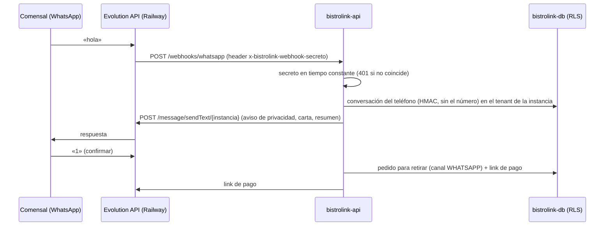

# Runbook: bot de pedidos por WhatsApp con Evolution API

> **Ticket:** BL-112 (HU-010) · **Relacionado:** HU-033 (link de pago), HU-036 (aviso de privacidad), HU-040 (pedidos para retirar), ADR 0003 (secretos en Infisical).
> **Última revisión:** 21/11/2026.

## 1. Qué es

El comensal le escribe al número de WhatsApp del local y arma un **pedido para retirar** con la carta numerada. Al confirmar, la API crea el pedido con el canal `WHATSAPP` (las mismas reglas que el retiro web: franja horaria, stock y precios del servidor) y le manda el **link de pago** de HU-033. El pago, el código R-NNN y la entrega siguen el flujo de siempre.

[Evolution API](https://github.com/evolution-foundation/evolution-api) conecta un número de WhatsApp como si fuera WhatsApp Web (Baileys) y nos reenvía cada mensaje por un webhook.



**Pasos de la conversación:** aviso de privacidad (sin aceptarlo no se toma el pedido) → carta numerada («3», «3 x2») → «0» para ver el resumen → «1» confirmar y pagar, «2» seguir, «3» vaciar. «menu» y «cancelar» sirven en cualquier paso. La conversación se olvida a los 30 minutos sin mensajes.

**Requisito del local:** tiene que tener habilitados los **pedidos para retirar** (Configuración). Fuera de la franja horaria el bot responde el horario y no toma pedidos.

## 2. Riesgos y límites (leer antes de conectar un número)

- **No es la API oficial de WhatsApp.** Evolution usa WhatsApp Web; Meta puede bloquear el número si detecta un uso automatizado. Usar **solo el chip del proyecto**, nunca un número personal ni el del local real.
- **No hay plantillas HSM de Meta.** Los textos del bot son fijos y están en el código (`apps/backend/src/whatsapp/conversacion.ts`). El criterio de aceptación original de HU-010 cambia por CR.
- **Una instancia, un tenant.** El mapeo instancia → tenant está en `EVOLUTION_INSTANCIAS`. Una pantalla para que cada local conecte su número queda fuera del MVP.

## 3. Variables

| Variable                   | Dónde                      | Qué es                                                                                      |
| -------------------------- | -------------------------- | ------------------------------------------------------------------------------------------- |
| `EVOLUTION_API_URL`        | Railway (`bistrolink-api`) | Dirección interna de Evolution, sin barra final. Referencia entre servicios de Railway.     |
| `EVOLUTION_INSTANCIAS`     | Railway (`bistrolink-api`) | `instancia=tenantId`, separadas por coma. Ej.: `bistrolink-staging=<uuid del tenant Demo>`. |
| `EVOLUTION_API_KEY`        | **Infisical** (secreto)    | La misma API key global de Evolution (`AUTHENTICATION_API_KEY` del servicio de Evolution).  |
| `WHATSAPP_WEBHOOK_SECRETO` | **Infisical** (secreto)    | Al menos 32 caracteres. Evolution lo manda en el header `x-bistrolink-webhook-secreto`.     |
| `WHATSAPP_TELEFONO_CLAVE`  | **Infisical** (secreto)    | Al menos 32 caracteres. Clave del HMAC con el que se guarda el teléfono en la conversación. |

- Si falta cualquiera, **el bot queda apagado**: el webhook responde 401 a todo y la API no manda nada. La API arranca igual.
- Generar cada secreto con `node -e "console.log(require('crypto').randomBytes(32).toString('base64url'))"`. Un valor distinto por entorno.
- Ningún valor va al repo, a Linear ni al chat. Mientras la sincronización de Infisical no esté activa (BL-237), se cargan a mano en Railway y se pasan a Infisical después (ADR 0003).
- Cambiar `WHATSAPP_TELEFONO_CLAVE` solo hace que las conversaciones abiertas empiecen de nuevo (pide otra vez el aviso). No afecta a los pedidos.

## 4. Evolution en Railway (staging, una vez)

1. Proyecto BistroLink, entorno **staging** → «+ New» → «Template» → **Evolution API** con la imagen fija `evoapicloud/evolution-api:v2.3.7` (no `latest`; las 2.4 piden activar una licencia).
2. La plantilla crea **su propio Postgres y su propio Redis** y un volumen. No usar `bistrolink-db`.
3. `AUTHENTICATION_API_KEY` del servicio de Evolution = el valor de `EVOLUTION_API_KEY`.
4. Abrir el manager de Evolution (`/manager`), crear la instancia `bistrolink-staging` y escanear el QR con el WhatsApp del chip. Esperar el estado `open`.
5. Cargar las variables de §3 en `bistrolink-api` y redeployar.
6. Configurar el webhook de la instancia (§5).

## 5. Webhook de la instancia

Con la API key de Evolution en una variable de la terminal (no escribirla en el comando):

```bash
curl -sS -X POST "$EVOLUTION_API_URL/webhook/set/bistrolink-staging" \
  -H "apikey: $EVOLUTION_API_KEY" -H "Content-Type: application/json" \
  -d '{
    "webhook": {
      "enabled": true,
      "url": "https://<api de staging>/webhooks/whatsapp",
      "headers": { "x-bistrolink-webhook-secreto": "'"$WHATSAPP_WEBHOOK_SECRETO"'" },
      "byEvents": false,
      "base64": false,
      "events": ["MESSAGES_UPSERT"]
    }
  }'
```

Solo hace falta `MESSAGES_UPSERT`. Para comprobarlo: `GET /webhook/find/bistrolink-staging` (devuelve la URL y los eventos) y mandarle «hola» al chip desde otro teléfono.

## 6. Local

`docker compose up -d bistrolink-evo` levanta Evolution 2.3.7 con su Postgres y su Redis en `http://localhost:8081` (API key de desarrollo `dev_key_local`). La API corre fuera de Docker, así que el webhook apunta a `http://host.docker.internal:3001/webhooks/whatsapp`. En `apps/backend/.env`:

```env
EVOLUTION_API_URL=http://localhost:8081
EVOLUTION_API_KEY=dev_key_local
EVOLUTION_INSTANCIAS=bistrolink-local=11111111-1111-1111-1111-111111111111
WHATSAPP_WEBHOOK_SECRETO=<generar, §3>
WHATSAPP_TELEFONO_CLAVE=<generar, §3>
```

## 7. Datos personales

- La conversación **no guarda el número**: la clave es `HMAC-SHA256(WHATSAPP_TELEFONO_CLAVE, tenant:número)`. Vence a los 30 minutos y se borra con el próximo mensaje del local; también se borra al eliminar el establecimiento.
- El número queda en el pedido (`retiro_contacto`) **solo** si el comensal aceptó el aviso de privacidad, igual que en el retiro web. Sale con la anonimización por contacto de siempre (runbook de privacidad).
- Los logs muestran solo los últimos 3 dígitos del número y nunca el texto de los mensajes.

## 8. Problemas comunes

| Síntoma                                      | Causa probable                                                                 |
| -------------------------------------------- | ------------------------------------------------------------------------------ |
| El chip no contesta y la API loguea 401      | `WHATSAPP_WEBHOOK_SECRETO` distinto en la API y en el webhook de la instancia. |
| La API loguea «el bot no está configurado»   | Falta una variable de §3 o un secreto tiene menos de 32 caracteres.            |
| «instancia sin tenant configurado»           | El nombre de la instancia no está en `EVOLUTION_INSTANCIAS`.                   |
| La API loguea «No se pudo mandar el mensaje» | Evolution caído o la instancia desconectada (volver a escanear el QR).         |
| El bot responde el horario y no la carta     | El local no tiene habilitado el retiro o está fuera de la franja.              |
